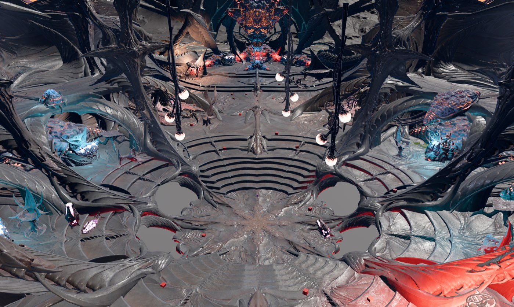

# bg3-rs

**An open-source reimplementation of Baldur's Gate 3 in Rust, on the [Bevy](https://bevyengine.org)
engine.** It aims to match the original's behaviour 1:1, quirks included.

bg3-rs ships **no game files**. It reads everything (levels, models, textures, stats, quest scripts)
straight from **your own installed copy** of Baldur's Gate 3, without modifying it.



> **Status: early and experimental.** You can fly through the game's levels in a viewer, and the
> game's quest-scripting engine already runs headlessly. It is **not playable yet**. The first
> playable target is the Nautiloid prologue.

## What works today

| Area | State |
|---|---|
| **Game archives** (`.pak`) | All 27 paks in the install read and verified: 1.07 M files, 159 GiB decompressed, zero failures |
| **Resource files** (LSF / LSX / LSJ) | All ~103,000 parse, and survive a write-and-reparse round trip |
| **3D models** (Granny `.GR2`) | All 285,055 parse, including the BitKnit2 compression; meshes and skeletons decoded |
| **Textures** | DDS plus the game's streamed *virtual textures*, all tile sets decode |
| **Levels** | Objects, templates, meshes, materials, terrain and lights are loaded and rendered |
| **Stats & localization** | All stats files with inheritance resolved; 237k English strings |
| **Quest scripting (Osiris)** | The compiled story loads, and our VM **replays a recorded session of the real game's opening with 100% matching behaviour**: 8,434 rule firings, 15,722 database changes, 16,511 queries, in the same order |
| Characters, animation, dialogue, combat, UI | Not started yet; see the roadmap |

More screenshots: [the Nautiloid doorway](docs/media/nautiloid-doorway.jpg) ·
[Act 1 terrain from above](docs/media/act1-terrain.jpg).

## Try it

You need:

- A legally obtained copy of **Baldur's Gate 3**. Development uses the macOS Steam build
  4.1.1.7631656. Windows and Linux (Steam/Proton, GOG) layouts are supported but less tested; see
  [docs/platforms.md](docs/platforms.md).
- A recent stable **Rust** toolchain ([rustup.rs](https://rustup.rs)).

```sh
git clone https://github.com/olukowski/bg3-rs
cd bg3-rs

# Check that your install is found (set BG3_INSTALL=/path/to/game if it isn't)
cargo run --release -p bg3x -- info

# Fly through the Nautiloid
cargo run --release -p bg3-viewer -- --camera=-25,30,-389 --look-at=-60,14,-389
```

**Viewer controls:** hold the right mouse button to look around · `W A S D` to move · `Q`/`E` to go
down/up · `Shift` to go faster.

Other things to try:

```sh
# Act 1's landscape (its terrain is split across sub-levels, listed by hand for now)
cargo run --release -p bg3-viewer -- WLD_Main_A \
  --terrain-levels WLD_Crashsite_D,WLD_Forest_G,WLD_Plains_D,WLD_GoblinCamp_D,WLD_VillageSubs_C,WLD_RangerCamp_I \
  --camera=0,700,-500 --look-at=0,0,150

# Inspect game data
cargo run --release -p bg3x -- stat Target_MainHandAttack   # a spell, with inheritance resolved
cargo run --release -p bg3x -- story -s                     # summary of the compiled quest scripts
cargo run --release -p bg3x -- --help                       # everything else
```

The first build takes a few minutes.

## How it works

The original game is mostly **data** (levels, stats, dialogue, compiled quest scripts) plus an
**engine** that interprets it. bg3-rs reads the data directly from your install and reimplements
the engine, layer by layer:

```
viewer / game (Bevy)       bg3-viewer: rendering, camera, materials, terrain, lights
simulation (headless)      bg3-osiris (quest-script VM) · bg3-stats · bg3-world
file formats (no Bevy)     bg3-pak · bg3-vfs · bg3-lsf · bg3-gr2 · bg3-vt · bg3-loca · bg3-story · bg3-material
install                    bg3-install (finds your game on macOS / Windows / Linux)
tools                      bg3x (command-line inspector) · osiris-trace (runtime log capture)
```

To get behaviour right rather than approximately right, the project follows a strict set of
rules ([ADR 0001](docs/adr/0001-provenance-and-extraction.md)):

1. **Data comes from your install at runtime.** Nothing from the game is ever committed.
2. **Behaviour is reimplemented, not copied.** Reverse engineering is used to *find and understand*
   the original logic. The Rust code is written from scratch and cites the original function it
   mirrors.
3. **Behaviour is verified against the real game.** For example, we captured the game's own
   quest-script log while starting a new game, and a test replays it against our VM and diffs every
   step ([details](docs/research/osiris-vm.md)).

New to the terminology (Osiris, LSF, GR2, virtual textures …)? See the [glossary](docs/README.md#glossary).

## Documentation

- [Documentation index & glossary](docs/README.md)
- [Roadmap](docs/roadmap.md)
- [Architecture](docs/architecture.md)
- [File formats](docs/formats/README.md)
- [Platforms](docs/platforms.md)

## How this project is built

Like [nv-rs](https://github.com/slaterain/nv-rs), bg3-rs is developed largely by **AI coding agents**
(Claude), directed and reviewed by the maintainer. The rules agents follow are in
[AGENTS.md](AGENTS.md). Every format reader is tested against the full game install, and behaviour
is checked against traces of the real game wherever possible.

## Contributing

Issues and pull requests are welcome, especially testing reports from Windows and Linux. Please read
[AGENTS.md](AGENTS.md) (it applies to humans too) and the
[provenance rules](docs/adr/0001-provenance-and-extraction.md). Never include game files,
extracted data, or decompiled code in a contribution.

## License

Licensed under either of [Apache License, Version 2.0](LICENSE-APACHE) or [MIT license](LICENSE-MIT)
at your option. Unless you explicitly state otherwise, any contribution intentionally submitted for
inclusion in the work by you, as defined in the Apache-2.0 license, shall be dual licensed as above,
without any additional terms or conditions.

bg3-rs is an unofficial fan project, not affiliated with Larian Studios, Wizards of the Coast or
Hasbro. See [LEGAL.md](LEGAL.md).
